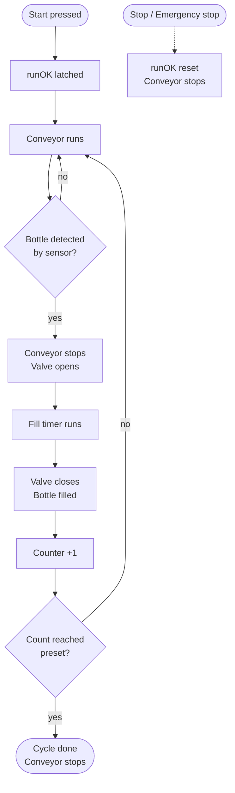

# Bottle Filler – CODESYS PLC Project (Ladder + Structured Text, simulated in Factory I/O)

A simulated automatic bottle filling station. A conveyor moves empty bottles forward, stops when a bottle is detected under the filling valve, fills it for a fixed time, releases it, and counts the filled bottles. After a set number of bottles the cycle finishes. The control logic runs on a **CODESYS** soft PLC and is operated through a **CODESYS HMI visualisation** (start, stop, emergency stop, status, bottle counter). The machine itself is a **Factory I/O** 3D simulation, so **no real hardware is used**.

> **Status:** completed and tested in simulation. The same logic is implemented twice, in Ladder Diagram (LD) and Structured Text (ST), and both versions behave identically.

---

## Table of contents

1. [What the machine does](#1-what-the-machine-does)
2. [Technologies and methods used](#2-technologies-and-methods-used)
3. [System overview](#3-system-overview)
4. [I/O list and variables](#4-io-list-and-variables)
5. [Control logic explained](#5-control-logic-explained)
6. [How I built it from scratch](#6-how-i-built-it-from-scratch)
7. [HMI visualisation](#7-hmi-visualisation)
8. [Ladder vs. Structured Text](#8-ladder-vs-structured-text)
9. [Testing and debugging](#9-testing-and-debugging)
10. [How to run this project](#10-how-to-run-this-project)
11. [Lessons learned](#11-lessons-learned)
12. [Possible improvements](#12-possible-improvements)

---

## 1. What the machine does

**The process, step by step:**

1. The operator presses **Start** on the HMI. The system latches into the "running" state.
2. The **conveyor motor** runs and moves a bottle toward the filling valve.
3. A **sensor** detects the bottle at the filling position. The conveyor **stops**.
4. The **valve opens** and a **timer** runs for the filling time.
5. When the timer finishes, the valve **closes** and the bottle counts as **filled**.
6. The **conveyor starts again** and moves the filled bottle away, bringing the next one in.
7. A **counter** counts each filled bottle. When the preset number is reached (5 bottles), the **cycle is done** and the conveyor stops.
8. **Stop** ends the run at any time. **Emergency stop** stops everything immediately.



---

## 2. Technologies and methods used

| Area | What I used |
|---|---|
| PLC software | **CODESYS V3.5 SP22 Patch 3** |
| Runtime | **CODESYS Control Win V3 x64** (soft PLC running on the PC) |
| Programming languages | **Ladder Diagram (LD)** and **Structured Text (ST)** according to **IEC 61131-3** |
| Simulation | **Factory I/O** (3D simulated bottle filling line) |
| HMI | **CODESYS Visualization** (buttons, indicators, counter display) |
| Version control | **Git / GitHub** |

**Methods and concepts applied**

- **Seal-in (latching) circuit** for start/stop control
- **Interlocking:** the valve can only open while the conveyor has stopped on a detected bottle
- **On-delay timer (TON)** for the filling time
- **Rising-edge detection (R_TRIG)** so each bottle is counted exactly once
- **Up-counter (CTU)** with preset value and reset input
- **Set / Reset coils** and the scan-order effects of writing the same variable in several places
- **Emergency stop** that overrides normal operation
- **Programs (POUs), global variable list (GVL)** and **function blocks** to structure the code
- **Online debugging:** breakpoints, single-cycle mode, watch lists

---

## 3. System overview

```
┌──────────────────────┐        ┌──────────────────────┐
│   CODESYS HMI        │        │    Factory I/O       │
│   Start / Stop /     │        │    3D simulation     │
│   Emergency stop     │        │    conveyor, sensor, │
│   Status, counter    │        │    valve, bottles    │
└──────────┬───────────┘        └──────────┬───────────┘
           │ variables                     │ inputs / outputs
           ▼                               ▼
        ┌──────────────────────────────────────┐
        │   CODESYS PLC program (LD / ST)      │
        │   runs on CODESYS Control Win V3 x64 │
        └──────────────────────────────────────┘
```

- The **PLC program** reads the sensor and operator commands and sets the motor and valve outputs.
- The **CODESYS HMI** gives the operator buttons and shows the machine state.
- **Factory I/O** reacts to the PLC outputs (conveyor moves, valve fills) and returns the sensor signal.

<!-- Add: how CODESYS is connected to Factory I/O (driver used and the settings) -->

---

## 4. I/O list and variables

**Operator inputs (from the HMI)**

| Variable | Type | Description |
|---|---|---|
| `start` | BOOL | Start push button (momentary) |
| `stop` | BOOL | Stop push button (momentary) |
| `emergencyStop` | BOOL | Emergency stop |
| `bottleFilledReset` | BOOL | Resets the bottle counter |

**Field signals (Factory I/O)**

| Variable | Type | Description |
|---|---|---|
| `ultraSonicSensor` | BOOL | TRUE when a bottle is at the filling position |
| `motorStart` | BOOL | Conveyor motor output |
| `valveStatus` | BOOL | Bottle in position and conveyor stopped |
| `openValve` | BOOL | Filling valve open command |

**Internal variables**

| Variable | Type | Description |
|---|---|---|
| `runOK` | BOOL | Latched "system running" state |
| `openValveTimer` | TON | Filling time timer |
| `openValveTimerElapsedTime` | TIME | Elapsed filling time |
| `closeValve` | BOOL | Fill time finished |
| `bottleFilled` | BOOL | One bottle completed |
| `bottleR_TRIG` | R_TRIG | One-scan pulse for each filled bottle |
| `filledBottleCounter` | CTU | Counts filled bottles (preset 5) |
| `filledBottleCounterCountValue` | INT | Current count, shown on the HMI |
| `cycleDone` | BOOL | Preset number of bottles reached |

---

## 5. Control logic explained

The logic is written as 13 rungs (ladder) and executed from top to bottom on every PLC scan.

| # | Logic | Purpose |
|---|---|---|
| 1 | `runOK := (start OR runOK) AND NOT stop` | **Seal-in:** start latches the run state, stop releases it |
| 2 | `motorStart := runOK` | Conveyor runs while the system is running |
| 3 | `valveStatus := motorStart AND ultraSonicSensor` | Bottle detected while the conveyor is running |
| 4 | `valveStatus` **resets** `motorStart` | Conveyor stops on the bottle |
| 5 | `openValve := valveStatus` | Open the valve |
| 6 | `openValveTimer(IN := openValve)` → `closeValve` | Fill time (TON) |
| 7 | `bottleFilled := closeValve` | Bottle is filled |
| 8 | `bottleFilled` **sets** `motorStart` | Conveyor moves the bottle on |
| 9 | `R_TRIG` → `CTU` (preset 5) → `cycleDone` | Count each filled bottle once |
| 10 | `cycleDone` **resets** `motorStart` | End of the batch, conveyor stops |
| 11 | `stop := emergencyStop` | Emergency stop acts as a stop |
| 12 | `stop` **resets** `runOK` | Drop the running state |
| 13 | `stop` **resets** `motorStart` | Stop the conveyor |

**Why the order matters:** several rungs write `motorStart`. In a PLC the **last write in the scan wins**, so the rung order is part of the logic. Moving a rung changes the behavior.

---

## 6. How I built it from scratch

1. **Installed CODESYS** (V3.5 SP22 Patch 3) and created a new *Standard project* with the **CODESYS Control Win V3 x64** soft PLC as the device, using `PLC_PRG` in **Ladder Diagram**.
2. **Wrote the process description** (the steps in section 1) and listed all inputs, outputs and internal signals (section 4) before drawing any logic.
3. **Declared the variables** in `PLC_PRG`: BOOLs for signals, `TON` for the fill timer, `R_TRIG` and `CTU` for counting.
4. **Built the start/stop seal-in** (rung 1), then the motor output (rung 2).
5. **Added the bottle detection and valve sequence** (rungs 3–8): sensor, conveyor stop, valve open, fill timer, valve close.
6. **Added the bottle counter** (rung 9–10) with `R_TRIG` and `CTU`, and the end-of-batch stop.
7. **Added the emergency stop** (rungs 11–13).
8. **Debugged online** with the watch window and single-cycle mode. This is where I found and fixed a scan-order problem: a reset coil and a normal coil wrote the same variable, so the motor output flickered.
9. **Rewrote the same logic in Structured Text** in a separate program (`bottleFillerInST`), and swapped which program the task calls, to prove both versions behave the same.
10. **Moved shared variables to a GVL** and tried splitting logic into function blocks to keep the code organized.
11. **Connected CODESYS to Factory I/O**, mapped the PLC variables to the simulated sensor, conveyor and valve, and tested the full cycle in 3D.
12. **Built the HMI visualisation** (section 7) to operate and monitor the machine.

---

## 7. HMI visualisation

The HMI was built with **CODESYS Visualization** and runs together with the PLC program.

| Element | Function |
|---|---|
| **Start** button | Starts the machine (momentary, *Tap variable* on `start`) |
| **Stop** button | Stops the machine normally (*Tap variable* on `stop`) |
| **Emergency stop** button | Stops everything (`emergencyStop`) |
| **Status indicators** | Show running, motor on, valve open and cycle done states |
| **Bottle counter** | Shows the number of bottles filled (`filledBottleCounterCountValue`) |

**Design choice:** Start and Stop use *Tap* rather than *Toggle*, like physical push buttons. A Toggle on `start` would stay TRUE after one click and conflict with the seal-in logic.


<!-- Add a screenshot of the HMI -->

---

## 8. Ladder vs. Structured Text

The logic exists in two versions:

| | Ladder (LD) | Structured Text (ST) |
|---|---|---|
| Program | `PLC_PRG` | `bottleFillerInST` |
| Normal coil | Coil | `x := condition;` |
| Set / Reset coil | `(S)` / `(R)` | `IF condition THEN x := TRUE/FALSE; END_IF;` |
| Series contacts | AND | `AND` |
| Parallel contacts | OR | `OR` |
| Function blocks | Boxes | Instance call with named parameters |

The main thing I had to watch for was the difference between a **normal coil** (written every scan, TRUE or FALSE) and an `IF` that only sets a value (which latches). Both versions were tested against each other and behave the same.

---

## 9. Testing and debugging

- Ran the full cycle in **Factory I/O**: start, bottle detection, fill, release, 5-bottle count, cycle done.
- Tested **stop** and **emergency stop** during different phases (conveyor running, valve open).
- Compared the **LD and ST versions** with the same inputs.
- Used the CODESYS debugging tools: **watch lists, breakpoints, single-cycle mode** and online forcing/writing of variables.

---

## 10. How to run this project

**Requirements**

- CODESYS V3.5 SP22 (or newer) with the CODESYS Control Win V3 x64 runtime
- Factory I/O (for the 3D simulation)

**Steps**

1. Open `bottleFiller.project` in CODESYS.
2. Start the **CODESYS Control Win V3 x64** runtime (the PLC simulation).
3. In the Devices tree, double-click the device and use **Scan Network** or select the local PLC.
4. **Build** the application (F11), then **Login** (Alt+F8) and **Download**.
5. Open the Factory I/O scene and set up the connection to CODESYS. <!-- add the driver and settings you used -->
6. **Start** the PLC (F5), then open the HMI visualisation and press **Start**.

To switch between the Ladder and Structured Text versions, change the program called in **Task Configuration → MainTask**. Only one should be active at a time.

---

## 11. Lessons learned

- A PLC executes **top to bottom on every scan**, so the **last write to a variable wins**. Several rungs writing the same output must be ordered on purpose.
- **Normal coils** follow their condition every scan. **Set/Reset** and `IF` assignments **hold** their value, which can cause latching bugs.
- Timers, counters and edge detectors must be **called every scan**, not only inside a conditional.
- Pure functions cannot hold state. Anything with memory belongs in a **function block**.
- A simulation (Factory I/O) makes it possible to test a complete machine cycle without hardware.

---

## 12. Possible improvements

- Make the emergency stop **latching**, with a separate reset, instead of following the input.
- Split the code into function blocks (for example `FB_Conveyor`, `FB_FillStation`, `FB_EmergencyStop`).
- Add a state machine (enumeration-based) for clearer sequencing.
- Add alarms and a fill-time measurement on the HMI.
- Test on a real PLC with real I/O.
